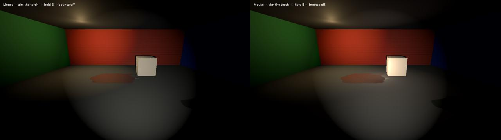

# Fake RTX for Godot 4

Ray-traced-looking light and water that also runs **in the browser and on phones**.

Godot's real global illumination (SDFGI, VoxelGI, SSIL, SSAO) only works in the Forward+ renderer. The web can only use the **Compatibility** renderer, which has none of it, and baked lightmaps don't work for levels built in code. Fake RTX gets part of the look back using real rays, at a small cost:

- **`FakeRtxBounce`**: bounce light for a flashlight or any moving light. Every physics frame a few physics rays follow the beam. A soft light is placed where they land, tinted by the surface they hit, so a red wall throws red light back. It is eased so it never pops. It follows Godot's own [faking GI](https://docs.godotengine.org/en/stable/tutorials/3d/global_illumination/faking_global_illumination.html) advice: no shadows, no specular.
- **`FakeRtxWater`**: puddles and pools with:
  - **reflections:** screen-space ray marching through the depth buffer with a binary-search refinement, plus a fallback so the water never shows black holes
  - **see-through:** you see the ground under the water (screen-space refraction), and it turns into a mirror at low angles (Fresnel)
  - **movement:** wind ripples and drip rings
  - **shape:** a ragged outline that is different for every puddle

  It needs no textures.



Both work in Forward+, Mobile and Compatibility, on desktop, web and phones. Made for SCP-1730 // SITE-13, a web horror game.

## Install

1. Copy `addons/fake_rtx` into your project's `addons/` folder.
2. Go to *Project → Project Settings → Plugins* and enable **Fake RTX**. This is optional, because the classes work without the plugin.

## Use

### Flashlight bounce

```gdscript
var bounce := FakeRtxBounce.new()
bounce.source = $Camera3D/Flashlight        # your SpotLight3D
bounce.exclude_bodies = [self]              # the player holding it
add_child(bounce)
```

You can also add a **FakeRtxBounce** node in the editor and pick the source light in the inspector.

| Setting | Default | What it does |
|---|---|---|
| `rays` | 3 | Rays per frame. One goes down the middle and the rest sweep the cone. |
| `ratio` | 0.6 | Share of the source energy that a white surface sends back. |
| `lift` | 0.45 | Distance of the bounce light from the surface. |
| `ease_speed` | 9 | How quickly the bounce follows the beam. |
| `collision_mask` | 1 | Physics layers the rays hit. |

The bounce colour comes from the hit body's mesh material (its albedo colour × the average of its albedo texture). To override it, set a `fake_rtx_albedo` meta (a `Color`) on the body.

### Water

Add a **FakeRtxWater** node about 2 mm above the floor and set `size`.

| Setting | Default | What it does |
|---|---|---|
| `deep_colour`, `murk_colour` | dark green | Tint of the water. |
| `ragged_edge` | on | Gives the puddle a natural, uneven outline. Turn it off for a rectangle. |
| `ripples`, `drips` | 1 | Strength of the wind ripples and the drip rings. |
| `reflection` | 1 | Strength of the mirror effect. |
| `clarity` | 0.9 | How much of the ground shows through. |

You can also use `fake_rtx_water.gdshader` on your own mesh.

## Limits

- Screen-space reflections only show what is on screen. Anything else falls back to the colour at the screen edge, which looks plausible but is not exact.
- In the Compatibility renderer each object can be lit by at most 8 lights. The bounce counts as one of them.
- The water reads the screen and depth textures. That costs one screen copy per frame when water is visible.

## Demo

Open the project in Godot 4.6 and press F5. Move the mouse to aim the torch, and hold **B** to compare with the bounce off.

## Licence

MIT. See [LICENSE](LICENSE).
# rtx-fake-godot
